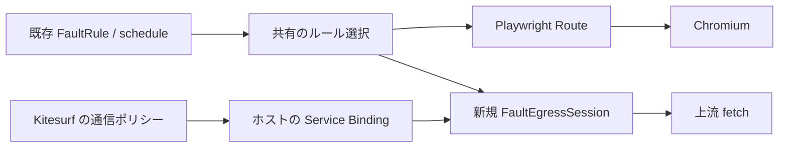

# Kitesurf の egress に障害を注入する chaosbringer モジュール

作成日: 2026-11-13

状態: 実装待ち。実装担当エージェントは、この設計を起点に探索 → Red → Green → Refactoring の順で進めてください。

## 実装するもの

chaosbringer monorepo に `@mizchi/kitesurf-faults` を追加し、既存の `FaultRule` を Kitesurf の `EngineHost.egress` で実行できるようにします。初版は HTTP エラー応答、通信失敗、上限付きの遅延に絞ります。

最初の完了例は、同じオリジンの `GET /api/cart` を初回だけ503にし、再試行は実サーバーへ通すテストです。DOM の最終状態、注入統計、実サーバーの呼び出し回数を合わせて検証します。Kitesurf の通常の読み込みが成功するだけでは完了にしません。

この Issue 本文を、別の環境でも読める設計の正本とします。実装時は同じ内容を `docs/superpowers/specs/2026-11-13-kitesurf-faults-design.md` に保存し、差分が生じたら理由を更新してください。

## 調査の基準

- chaosbringer: [1ecee37](https://github.com/mizchi/chaosbringer/commit/1ecee37fa846943076dd7d9fb8b09c8c94cae1d4)。ローカルの古い main や未コミットの CDP 対応差分を前提にしません。
- Kitesurf: [mizchi/kitesurf の 58d10e6](https://github.com/mizchi/kitesurf/commit/58d10e608692f20de9cd2ae3c05d8f7a082aecae)。Node 対応のレビュー先は [mizchi/kitesurf#1](https://github.com/mizchi/kitesurf/pull/1) です。
- 着手時に両リポジトリの最新コードと指示を確認し、利用した revision を統合テストの成果物に記録してください。

既存の接続点は次のとおりです。

| 接続点 | 現在の役割 |
| --- | --- |
| [playwright-faults/src/types.ts](https://github.com/mizchi/chaosbringer/blob/1ecee37fa846943076dd7d9fb8b09c8c94cae1d4/packages/playwright-faults/src/types.ts) | `FaultRule`、`FaultSchedule`、統計型。現在は `resourceTypes` もあります |
| [playwright-faults/src/schedule.ts](https://github.com/mizchi/chaosbringer/blob/1ecee37fa846943076dd7d9fb8b09c8c94cae1d4/packages/playwright-faults/src/schedule.ts) | 発生回数と確率による判定 |
| [chaosbringer/src/fault-router.ts](https://github.com/mizchi/chaosbringer/blob/1ecee37fa846943076dd7d9fb8b09c8c94cae1d4/packages/chaosbringer/src/fault-router.ts) | ルールのコンパイル・選択・統計と Playwright Route の実行 |
| [chaosbringer/src/cdp.ts](https://github.com/mizchi/chaosbringer/blob/1ecee37fa846943076dd7d9fb8b09c8c94cae1d4/packages/chaosbringer/src/cdp.ts) | 既存ブラウザへの CDP 接続 |
| [Kitesurf host.ts](https://github.com/mizchi/kitesurf/blob/58d10e608692f20de9cd2ae3c05d8f7a082aecae/packages/engine/src/host.ts) | 接続ごとに `egress(env, ctx)` を作るホストフック |
| [Kitesurf outbound.ts](https://github.com/mizchi/kitesurf/blob/58d10e608692f20de9cd2ae3c05d8f7a082aecae/packages/engine/src/eval/outbound.ts) | エンジンの通信ポリシーを適用し、その後にホストの transport を呼ぶ処理 |
| [Kitesurf embed.ts](https://github.com/mizchi/kitesurf/blob/58d10e608692f20de9cd2ae3c05d8f7a082aecae/packages/engine/src/embed.ts) | エンジンを包む Worker 用の公開面 |
| [Lightbringer core.ts](https://github.com/mizchi/chaosbringer/blob/1ecee37fa846943076dd7d9fb8b09c8c94cae1d4/packages/lightbringer/src/core.ts) | Chromium の操作単位の性能計測 |

## 対象範囲

初版では、新パッケージ、共有判定の小さな移動、Kitesurf を包むローカル Worker の統合例、対象を絞ったテストを追加します。通常の Chromium 用 API と既存のルール選択結果は維持します。

次は後続の課題にします。

- Kitesurf 用の汎用ブラウザ抽象化や、crawler 全体の置き換え。
- Kitesurf Node ホストへの通信ポリシー追加。
- `hang`、CPU 制限、ページ内 API の改変、iframe・ストレージ障害。
- `resourceTypes` による選択と、Chromium の `errorCode` の完全な再現。
- Chromium の通信を通す Workers プロキシ。
- Lighthouse の採点、Kitesurf 上の Web Vitals・V8 トレース・coverage。
- 本番デプロイ、npm publish、PR 作成。これらをこの Issue の実装完了条件に含めません。

## 構成



`EngineHost.egress` は `fetch(request): Promise<Response>` という構造を受け取ります。新パッケージのコアもこの形に合わせ、Kitesurf の内部型を deep import しません。公開名を持つ専用インターフェースを Kitesurf 側に追加する必要はありません。

Kitesurf の `externalOutbound` は通信ポリシーを迂回する経路です。この設計では使いません。URL フィルター、CORS、Cookie、private-network 制御を残したまま、その後段の transport で障害を実行します。

CDP Fetch interception は、判定が約5秒届かなければ通信を継続します。障害の実行をこの待機に依存させず、egress で行います。調査した revision のヘッダー待機期限は通常10秒、最上位 document は25秒です。障害注入のためにこれらを延長しません。[interception の期限](https://github.com/mizchi/kitesurf/blob/58d10e608692f20de9cd2ae3c05d8f7a082aecae/packages/engine/src/cdp/fetch-interception.ts)

## パッケージと共有する実装

`packages/kitesurf-faults/` に `@mizchi/kitesurf-faults` を作ります。コアの実行時依存は Web 標準 API と共有判定だけとし、Playwright、Node 組み込みモジュール、Kitesurf の wasm をロードしません。

共有するのは、既に Chromium と新アダプターの両方が必要とする処理だけです。

- `compileFaultRules`、`pickFaultRule`、`faultStatsOf` と必要な型を、Playwright 非依存のモジュールへ移します。
- 配置は `packages/playwright-faults/src/network.ts`、公開入口は `@mizchi/playwright-faults/network` とします。新しい共通パッケージは増やしません。
- 既存の `fault-router.ts` と公開 export は re-export で互換性を保ちます。Route の `abort / fulfill / continue` と crawler の処理は移しません。
- seeded RNG は既存の mulberry32 と同じ列を使います。共有が必要な `createRng` だけを移して再 export し、`weightedPick` などの操作選択には触れません。
- 状態はセッションが所有し、ルールの選択ロジックから外部 I/O を分離します。既存の mutable counter の意味を、移動に合わせて変更しません。

共有モジュールの移動は、既存のテストで選択順・乱数消費・統計が変わらないことを示す独立した変更にします。

## 提案 API

以下は実装対象の API 案です。既存 API として扱わないでください。

```ts
import type { FaultInjectionStats, FaultRule } from "@mizchi/playwright-faults";

export interface FetchTransport {
  fetch(request: Request): Promise<Response>;
}

export interface FaultEgressOptions {
  rules: readonly FaultRule[];
  seed: number;
  maxDelayMs?: number; // default: 5_000
}

export interface FaultEgressSession extends FetchTransport {
  stats(): FaultInjectionStats[];
  dispose(): Promise<void>;
}

export function createFaultEgress(
  upstream: FetchTransport,
  options: FaultEgressOptions,
): FaultEgressSession;
```

factory はルールを検証・複製し、コンパイルと RNG の初期化を一度だけ行います。呼び出し元の配列や RegExp を変更しません。`stats()` は snapshot を返し、外から状態を変更できないようにします。`seed` は uint32 の整数に限定します。

## 初版の障害の意味

| 指定 | 動作 |
| --- | --- |
| 対象外・判定が pass | 元の Request を上流へ一度だけ渡す |
| `status` | 上流を呼ばず指定した HTTP エラー応答を返す |
| `abort` | 上流を呼ばず、識別可能な合成エラーで reject する |
| `delay` | abort 可能な待機の後、元の Request を上流へ一度だけ渡す |

`status` は初版では400〜599を受け付けます。body と contentType の省略時の値は、既存の Playwright 側と揃えます。503という HTTP 応答と、fetch 自体が reject する通信失敗を混同しません。合成応答では、実サーバー側の障害や OTel span が発生したとは報告しません。

`abort.errorCode` は省略または `"failed"` だけを受け付けます。Workers の transport から Chromium 固有の全エラーコードを再現できるとは扱いません。

`delay.ms` は有限かつ0以上、`maxDelayMs` 以下とし、上限超過は設定エラーにします。遅延を黙って切り詰めません。`maxDelayMs` 自体も0〜5,000に制限します。エンジンの通信期限はそのまま適用され、遅延後の上流通信まで必ず成功するとは保証しません。

`hang`、`resourceTypes` が指定されたルール、未対応の障害 kind、無効な正規表現・確率・schedule は factory で拒否します。確率と schedule の同時指定も拒否します。

egress に届く Request からは `x-kitesurf-*` が除去され、リソース種別を確実に取得できません。拡張子や `Accept` から種別を推測して `resourceTypes` を実装しないでください。空配列を含め、このフィールドの指定は初版では明示的なエラーにします。

## 順序と統計

ルール選択は既存の `pickFaultRule` と同じ関数を使います。

- URL・method が一致したルールについて、先に成立したルールを採用します。
- schedule はルールごとの0始まりの発生回数で進みます。先行ルールに抑制された scheduled rule も回数が進み、`suppressed` に残ります。
- schedule は乱数を消費しません。確率0も乱数を消費しません。
- 判定とカウンター更新は、最初の await より前に完了します。遅延の終了順で発生回数を決めません。
- `matched / injected / suppressed` は既存の意味を保ちます。`injected` は選択された障害の数であり、ページが応答を受信した証明には使いません。

回数は、この transport に実際に届いた呼び出しを数えます。キャッシュからの応答は数えず、到達した OPTIONS やリダイレクト先の別呼び出しは対象になり得ます。最初の fixture は同一オリジンの GET に限定し、これらを混ぜません。

同じ seed でも、異なるブラウザの通信順や操作列が同一になるとは保証しません。比較には対象 URL・method を限定した schedule を使います。同じルールに複数のリクエストが並行到着した場合、どれが初回になるかは到着順に依存します。

## キャンセルと後始末

`Request.signal` とセッションの dispose の両方で、遅延待機を中断できるようにします。既に abort 済みのリクエストは判定前に reject し、カウンターを進めません。待機中の中断では上流を呼びません。

`dispose()` は繰り返し呼べます。保留中の待機と処理中の上流通信を中断し、その後の fetch は reject します。終了時には timer と abort listener を解放します。統計の snapshot は dispose 後も取得できます。

通過させる Request の URL、method、body、headers、credentials、redirect の設定を維持します。上流 Response はストリームのまま返し、本文を先読みしません。所有したのに返さない Response がある場合だけ、本文を cancel します。

## Workers との接続と状態の寿命

普通の JavaScript の closure や `FaultEgressSession` オブジェクトを、そのまま `ctx.exports` の props に渡してはいけません。props は永続的にシリアライズ可能な値と Service Binding に制限されます。[Workers context の仕様](https://developers.cloudflare.com/workers/runtime-apis/context/#specifying-ctxprops-when-using-ctxexports)

初版の統合例では、同じホスト Worker に次の構成を置きます。

1. テスト所有の run ごとに `FaultEgressSession` を一つ作り、ホスト側のメモリに保持します。
2. `ChaosEgress extends WorkerEntrypoint` を export し、`fetch` は run の session に委譲します。WorkerEntrypoint のインスタンスフィールドにカウンターを置きません。
3. `ctx.exports.ChaosEgress({ props: { runId } })` という Service Binding を作り、`EngineHost.egress` から返します。
4. run と CDP 接続は1対1にします。ナビゲーションでは run を作り直しません。別接続とカウンターや RNG を共有しません。
5. テスト harness が try/finally で統計を回収し、CDP 接続と run を閉じます。早期終了・接続エラーでも dispose します。

run の registry は、このローカル統合例のホスト内部に限定します。所有者の終了時に削除し、run 数と保持時間に上限を設けます。lookup が失敗したら `run-lost` エラーとして実験を失敗させます。新しい空の session を作ったり、素通しに切り替えたりしません。

Worker の再起動や別 isolate をまたぐ状態の継続、分散 run 管理、Durable Object による永続化は初版の範囲外です。Service Binding を経由した複数回の呼び出しが同じ状態に到達することは、実際の workerd で必ず検証します。

制御面の run 作成・統計回収・dispose はテスト harness だけが操作します。ページ JavaScript が plan や runId を選び直せる経路は作りません。停止するプロセスは、テストが起動したものだけにします。

## 統合例と依存関係

`examples/kitesurf-faults/` に、ホスト Worker、同一オリジンの fixture、起動・停止を所有する runner を置きます。

Kitesurf の `@kitesurf/engine` は調査時点で private なソースパッケージです。存在しない npm 配布を依存として指定しません。runner は明示された `KITESURF_DIR` から checkout と revision、ビルド済み資産を検証し、公開入口の `@kitesurf/engine/embed` を解決します。ビルド時に必要な import 解決と wrangler 設定は、再現用の手順として例に含めます。

機械固有の絶対パス、未コミット変更、`latest` だけの指定に依存しません。revision の不一致や不足した資産はテスト開始前に報告します。通常の単体テストは Kitesurf checkout がなくても実行できますが、明示的に選んだ統合テストを不足環境のまま成功扱いで skip しません。

CDP は browser endpoint の `/devtools/browser` を使います。既存の chaosbringer の `cdpEndpoint` を接続点として利用できますが、crawler 全体の動作保証を初版に含めません。最初は小さな CDP 操作で navigate・evaluate・DOM 検証までを実行します。Playwright との互換性に不足があれば、fixture の CDP クライアントだけを直接接続にし、汎用 browser adapter は追加しません。

ページの Runtime.evaluate、実ページの fetch、loaded worker の globalOutbound から egress transport に届く経路を含めます。親 Worker から factory を直接呼ぶだけのテストで統合完了とはしません。

## 最初に行う接続検証

大きなリファクタリングの前に、ローカル workerd で以下を確認してください。

- Kitesurf がホストの egress Service Binding を受け取り、実ページの fetch がそこへ届く。
- 同一 run の複数呼び出しで回数が維持され、別 run と混ざらない。
- ページの再ナビゲーション後も同じ run の回数を維持する。
- run 終了とリクエスト中断が、RPC 越しの待機にどう伝わるかを確認する。Request.signal が失われる経路では、ホスト所有の dispose と有限な待機上限で後始末する。
- engine 側で拒否される通信は transport に到達せず、障害注入を有効にしても許可に変わらない。

既存の公開 hook だけで成立しない場合は、ここで制約と最小の追加契約を Issue に追記してください。通信ポリシーの迂回や、Kitesurf への大きな設計変更で穴埋めしません。chaosbringer 側だけで成立する範囲を維持します。

## テストと受け入れ条件

TDD で、まず下記の対象テストを失敗させてから実装します。単体の待機テストには fake timers を使い、実時間の長い sleep を増やしません。

- [ ] 空ルール・非一致・pass では上流を一度だけ呼び、Request と Response の内容を維持する。
- [ ] 初回503・次回passで、応答が503→200、統計が matched=2 / injected=1、上流は一度になる。
- [ ] abort は上流を呼ばず reject し、HTTP 503とは別の結果になる。
- [ ] delay は期限前に上流を呼ばず、期限後に一度だけ呼ぶ。
- [ ] 待機中の abort・dispose で上流を呼ばず、timer と listener が残らない。重複 dispose と終了後の fetch も検証する。
- [ ] リクエストの並行実行でも、回数の割り当てが待機終了順で変わらない。
- [ ] 同じ seed と同じ入力列で判定列が一致する。schedule・確率0の RNG 非消費、先行ルールと suppressed の既存ケースを維持する。
- [ ] 無効な設定、未対応 hang / resourceTypes / errorCode を開始時に拒否する。
- [ ] 通常の Playwright 経路について、共有処理を移す前後の選択・統計が一致する。
- [ ] 実 workerd＋Kitesurf で、正しい fixture は初回503から復旧する。503を処理できない fixture は同じ oracle で失敗する。
- [ ] ページ結果に加えて注入統計と上流回数を検証する。存在しない URL を指定した場合は「未注入」として検出する。
- [ ] 同時に二つの run を起動しても両方の初回が503になる。再ナビゲーションと run の破棄も実際の RPC 境界で検証する。
- [ ] エンジンの URL フィルターで拒否した URL は上流・注入 transport のどちらにも届かない。
- [ ] uncaught な workerd エラー、統計欠落、run-lost、未完了の後始末を成功扱いにしない。

タスクは Node 24+、pnpm、既存の justfile を使います。対象を絞る入口を追加し、少なくとも次のコマンドを提供してください。下記の新パッケージ用コマンドは実装後に利用可能になる予定です。

```sh
just pkg @mizchi/playwright-faults build
just pkg @mizchi/playwright-faults test
just pkg @mizchi/kitesurf-faults build
just pkg @mizchi/kitesurf-faults test
just pkg chaosbringer test src/fault-router.test.ts src/fault-rule-race.test.ts
KITESURF_DIR=/path/to/kitesurf just kitesurf-faults-integration
```

既存テスト名は着手時に確認し、移動した部分とその利用箇所に必要な範囲を実行します。全 monorepo のブラウザテストを常時回す変更は加えません。通常 CI には新パッケージの build と単体テストを接続し、Kitesurf が必要な統合テストは revision を固定した明示的な入口にします。

## Lightbringer と A/B への接続

同じ障害シナリオを Chromium で実行するときは、既存の Playwright Route と Lightbringer を使います。Kitesurf は障害時の DOM・例外・復旧を検証する実行先として追加します。

Kitesurf の `Performance / Tracing` は未実装で、PerformanceObserver もスタブです。取得できない性能指標は欠測として扱い、0や Lighthouse の満点に変換しません。エンジンの違う数値を直接 A/B の性能改善率として比較することも避けます。Lighthouse の採点や Workers プロキシは、このモジュールの後続課題です。

## 実装担当への引き継ぎ

1. 最新 main から作業ブランチまたは独立 worktree を作成し、既存の未コミット作業を変更しない。
2. 最初に Service Binding・状態保持・実ページの fetch の接続検証を行う。
3. 共有判定の移動を、既存テストを維持する小さな変更として完了する。
4. 新パッケージの失敗するテストを追加し、status・abort・delay・後始末を実装する。
5. 統合例に正しい実装と壊れた実装の fixture を用意し、同じ検証が前者で通り後者で落ちることを示す。
6. 利用 revision、実行したチェック、既知の制約を Issue に残す。設計変更が必要なら理由と影響する受け入れ条件を併記する。
7. 利用者のレビュー前に deploy・publish・PR 作成は行わない。実装と検証の結果を、レビューできる差分と実行記録として残す。
## 差分（2026-11-13）

上の本文は Issue #216 の本文をそのまま写したものです（「状態: 実装待ち」も当時の記述のままです）。実装は作業ブランチ `kitesurf-faults` の5コミットで行いました。本文と実装が違う点、本文に書かれていなかった判断を、ここに理由と影響する受け入れ条件とともに記録します。

証拠に挙げる `result-default.json`・`result-reqsignal.json`・`result-ctl.json`・`wrangler-*.log` は、実装前の接続検証（spike、リポジトリ外の作業記録）の成果物です。`kitesurf-integration.json` は統合テストの成果物で、`examples/kitesurf-faults/artifacts/` に書かれます（git 管理外）。

### 設計の訂正と具体化

1. **externalOutbound の説明**
   - 何が違うか: 本文は「`externalOutbound` は通信ポリシーを迂回する経路」と書いています。58d10e6 の `outbound.ts` では、`externalOutbound` でも fetchPolicy（URL フィルター・CORS・Cookie・private-network）は動きます。変わるのは `hostEgress=true` による WBA 署名なし・preflight キャッシュ非共有・opaque stylesheet キャッシュ無効と、egress より優先されることです。
   - 理由（証拠）: `packages/engine/src/eval/outbound.ts:434-436` と `:83` のコメント、`cdp/connection.ts:244`。
   - 判断: egress を使う方針は変えません。本文の記述だけを訂正します。
   - 影響する受け入れ条件: なし。

2. **compat flag `enable_request_signal` が必要**
   - 何が違うか: 本文は `Request.signal` とセッションの dispose の両方で待機を中断するとしています。Service Binding 越しの `ChaosEgress` では、ホスト Worker に `enable_request_signal` がないと `Request.signal` は存在しても発火しません。エンジンの10秒期限や CDP 切断では、呼び出し側の IoContext が黙って取り消され、`finally` も実行されません。
   - 理由（証拠）: spike 4b・4c。`result-default.json` では signalAborts=0・pending=1 のまま漏れ、`result-reqsignal.json` では signal-abort・pending=0。
   - 判断: 統合例の `wrangler.jsonc` の `compatibility_flags` に `enable_request_signal` を必須で入れ、runner は起動前にその存在を確認します。`@mizchi/kitesurf-faults` 本体は後片付けを `finally` に依存させず、settle する resolver の中で timer と listener を外し、dispose が自分で保留中の待機を破棄します。
   - 影響する受け入れ条件: 「待機中の abort・dispose で上流を呼ばず、timer と listener が残らない」（統合部分）。

3. **ページ側の AbortController は egress に伝わらない**
   - 何が違うか: 本文は「待機中の中断では上流を呼ばない」としています。Kitesurf の session 経路 `sessionRequest` が signal なしで Request を作り直すため、ページで fetch を abort しても egress の遅延待機は続き、その後に上流が呼ばれます。flag の有無には関係しません。
   - 理由（証拠）: spike 4a（ページは約316 ms で AbortError、egress は3001 ms 待機後に上流1回）。`outbound.ts:209-216`、`page-script/src/session-outbound.ts:101-145`。
   - 判断: 「中断したら上流を呼ばない」は単体テスト（`Request.signal`）で検証し、統合ではエンジン期限・CDP 切断・host dispose の経路（S9b・S9c）で検証します。ページ側 abort の挙動は既知の制約とし、Kitesurf 側の修正提案は後続課題にします。
   - 影響する受け入れ条件: 「待機中の abort・dispose で上流を呼ばず…」（統合部分）。

4. **run と CDP 接続の結び付け方**
   - 何が違うか: 本文は `ctx.exports.ChaosEgress({ props: { runId } })` を `EngineHost.egress` から返すとしています。`EngineHost.egress(env, ctx)` は Request も connectionId も受け取らないため、hook の中では runId を知る手段がありません。
   - 理由（証拠）: `packages/engine/src/host.ts:63`、`cdp/connection.ts:238-245`。
   - 判断: `KitesurfEngine` のサブクラスで `fetch()` を override し、`/devtools/browser?run=<id>` の upgrade から runId を読んで `host()` の closure に渡します。run 未指定は400、未登録・dispose 済みは409で、素通しにはしません。接続終了を知る手段は telemetry の `session_end` だけなので、dispose はテスト harness の try/finally が持ちます。
   - 影響する受け入れ条件: なし（実装方法の具体化）。

5. **uncaught な workerd エラーの判定**
   - 何が違うか: 本文は「uncaught な workerd エラーを成功扱いにしない」としています。障害と無関係に、ナビゲーションごとの `script terminated for unknown reasons` と切断時の `Uncaught Error: Network connection lost.` が出ます。egress が throw した abort 障害と run-lost も、workerd には `Uncaught Error: <msg>` として記録されます。
   - 理由（証拠）: spike の `wrangler-*.log`。
   - 判断: 限られた allowlist と、マーカー `kitesurf-faults: injected abort` の行数を `stats.injected` と照合する方法で判定します。それ以外の Uncaught は失敗です。
   - 影響する受け入れ条件: 「uncaught な workerd エラー…を成功扱いにしない」。

6. **上流へ渡す Request**
   - 何が違うか: 本文は「元の Request を上流へ一度だけ渡す」としています。dispose で処理中の上流通信を中断するには signal を合成する必要があり、同じ Request オブジェクトは渡せません。
   - 判断: `new Request(request, { signal: AbortSignal.any([request.signal, 呼び出しごとの signal]) })` を一度だけ渡します。URL・method・headers・body・credentials・redirect は維持し、単体テストで内容の一致を検証します（同一性ではありません）。Response は上流のオブジェクトをそのままストリームで返します。
   - 影響する受け入れ条件: 「空ルール・非一致・pass では上流を一度だけ呼び、Request と Response の内容を維持する」（Request は内容一致で検証）。

7. **compileFaultRules のエラー接頭辞**
   - 何が違うか: 本文に記載はありません。`chaosbringer: faultInjection rule ...` というメッセージは `fault-router.test.ts:479-520` で固定されています。
   - 判断: 移動後も既定の接頭辞は `chaosbringer` のままにし、kitesurf-faults は引数で `kitesurf-faults` を渡します。
   - 影響する受け入れ条件: なし。

8. **status 既定値の共有**
   - 何が違うか: 本文は「body と contentType の省略時の値は既存の Playwright 側と揃える」としています。その既定値は chaosbringer の `applyFault` にしか書かれていませんでした。
   - 判断: `@mizchi/playwright-faults/network` に `faultStatusBody`・`DEFAULT_STATUS_CONTENT_TYPE`・`DEFAULT_ABORT_ERROR_CODE` を置き、両方から使います。移動コミットに含め、挙動は変えていません。
   - 影響する受け入れ条件: なし。

9. **wrangler / workerd のバージョン**
   - 何が違うか: 本文に記載はありません。chaosbringer の lockfile は wrangler 4.148.0 ですが、検証できたのは Kitesurf 自身の wrangler 4.131.2 / workerd 1.20260911.1 です。chaosbringer は vitest 5（vite-plus）、Kitesurf は vitest 4 と `@cloudflare/vitest-plugin` です。
   - 判断: runner は `$KITESURF_DIR/packages/engine/node_modules/.bin/wrangler` を使い、バージョンを成果物に記録します。例に wrangler 依存を追加せず、pool-workers も導入しません。
   - 影響する受け入れ条件: なし。

10. **エンジン自身の読み込みも egress に届く**
    - 何が違うか: 本文は「回数はこの transport に届いた呼び出しを数える」としています。最上位 document の GET、CSS、script、module graph、CORS preflight、各リダイレクトも egress に届きます。
    - 理由（証拠）: spike（`GET / occ=0` が egress に記録された）。
    - 判断: 統合のルールは URL を完全一致の正規表現（`^https://shop\.invalid/api/cart$`）と method GET で限定します。
    - 影響する受け入れ条件: なし。

11. **Kitesurf revision**
    - 何が違うか: 着手時の Kitesurf main は `fb4dd59971458ff10047d8e8581d078b485345e8` でした。58d10e6 は main に PR #1（Node ホスト）を足したもので、`host.ts`・`outbound.ts`・`embed.ts`・`cdp/**`・engine の `package.json`・`wrangler.jsonc` は main とバイト単位で同一です。
    - 判断: 固定は 58d10e6 のままにし、成果物に main の HEAD も記録します。
    - 影響する受け入れ条件: なし。

12. **CDP クライアント**
    - 何が違うか: 本文は既存の `cdpEndpoint` を接続点として使えるとしています。`cdpEndpointUrl` は chaosbringer の index から export されていません。また `ChaosCrawler` に `faultInjection` を渡すと `page.route`（CDP Fetch interception）が入り、二重注入と5秒の自動 continue が起きます。
    - 判断: 統合は Node 24 の `WebSocket` による最小の CDP クライアントで行います。crawler と Playwright の接続は初版に含めません。
    - 影響する受け入れ条件: なし。

13. **この環境での Kitesurf 資産ビルド（環境依存のみ）**
    - 何が違うか: 作業コンテナの proxy が GitHub の archive tarball を403で拒否するため、bats-core の取得に失敗しました。dev_build では bats-core を使いません。
    - 判断: コンテナ内では Bazel の `--override_repository` で空のスタブに差し替えて回避しました。これはリポジトリに入れていません。例の README には通常の手順（`pnpm install --frozen-lockfile && pnpm run build`）を書いています。
    - 影響する受け入れ条件: なし。

### コミット1: 共有判定の移動（`@mizchi/playwright-faults/network`）

14. **`just` がない環境での実行**
    - 何が違うか: 作業コンテナに `just` がありません。`just pkg <name> <args>` は、justfile のレシピの展開である `pnpm -F <name> <args>` として実行しました。`just kitesurf-faults-integration` も、レシピの2行をそのまま実行して確認しました。
    - 影響する受け入れ条件: なし（同じコマンド）。

15. **CHANGELOG を編集しない**
    - 何が違うか: 実装計画には playwright-faults の `CHANGELOG.md` に Unreleased の項目を足す予定がありました。CHANGELOG はリリース作業が持つため編集していません。`./network` の入口は `packages/playwright-faults/README.md` に書いています。新パッケージの `CHANGELOG.md` も作っていません（初回リリースで作られます）。
    - 影響する受け入れ条件: なし。

16. **chaosbringer の `createRng` は残す**
    - 何が違うか: `packages/chaosbringer/src/random.ts` は自前の `createRng` を残しています（re-export は任意としていました）。代わりに `fault-pick-order.test.ts` が、移動前に記録した seed 0・1234・0xffffffff の mulberry32 列を固定し、`@mizchi/playwright-faults/network` の `createRng` が同じ列を返すことを検証します。
    - 影響する受け入れ条件: なし（構造ではなく値の一致で検証）。

17. **characterisation テストの順序**
    - 何が違うか: 共有の `createRng` は 1ecee37 では export されていなかったため、移動前の実行では列をリテラルとして固定し、パッケージ間の一致は移動後に足しました。`faultStatusBody` も移動前には存在しないため、移動前は記録用の偽 Route を使って `applyFault` 経由で既定値（abort `failed`、`{"error":503}` と `application/json`、明示的な `""` の body）を固定しました。関数自体は `network.test.ts` で検証します。
    - 影響する受け入れ条件: 「通常の Playwright 経路について、共有処理を移す前後の選択・統計が一致する」（同じテストファイルが移動前後とも通ることで引き続き満たします）。

### コミット2: `@mizchi/kitesurf-faults`

18. **`src/errors.ts` の追加**
    - `KitesurfFaultsError`・`KitesurfFaultsErrorCode`・`INJECTED_ABORT_MARKER` を置き、`validate.ts` と `egress.ts` が循環なしで共有します。影響する受け入れ条件: なし。

19. **エラーコードは3種類**
    - 何が違うか: `KitesurfFaultsError.code` は `invalid-config`・`injected-abort`・`disposed` の3つで、計画にあった `aborted` は削りました。呼び出し側の中断は、`fetch` と同じく `request.signal.reason`（DOMException の AbortError）で reject するため、`aborted` を作る経路がありません。
    - 影響する受け入れ条件: なし。

20. **中断は呼び出しごとの AbortController**
    - 何が違うか: 計画ではセッション全体の `life` signal を `AbortSignal.any` で合成する予定でした。実装は呼び出しごとに AbortController を作ってセッションの in-flight Set に入れ、`dispose()` がそれぞれを abort します。
    - 理由（証拠）: workerd では、セッションは制御リクエストの文脈で作られ、別の egress 呼び出しの文脈から使われます。spike の動いたホストは、この状況で呼び出しごとの controller を使っていました。timer・listener・signal を、それを使う文脈の中に留めるためです。上流には引き続き `AbortSignal.any([request.signal, 呼び出しの signal])` を渡します。
    - 影響する受け入れ条件: 「待機中の abort・dispose で上流を呼ばず、timer と listener が残らない」。単体は `cancel.test.ts`、RPC 境界は統合の S9c で検証しました。

21. **lockfile**
    - 何が違うか: 素の `pnpm install` は、すべての importer で vitest の `vite` peer を2つ目の `vite@8.3.8` に解決し直し、ワークスペースの「Vite は1つ」という規則（`pnpm-workspace.yaml` のコメント）を壊しました。その変更は戻し、lockfile の差分は新しい importer ブロックだけにしています（`packages/cf-faults` と同じ解決結果に `link:../playwright-faults` を足したもの）。`pnpm install --frozen-lockfile` は通ります。
    - 影響する受け入れ条件: なし。

22. **listener の数え方**
    - 何が違うか: `cancel.test.ts` は `node:events` の `getEventListeners` ではなく、`request.signal` の add/removeEventListener を数える probe を使います。テストを含めて `packages/kitesurf-faults/src` に `node:`・`playwright`・`@kitesurf` の import がない、という確認を文字どおりに保つためです。明示的な `removeEventListener` があって初めて外れたと数えるので、より厳しい確認です。
    - 影響する受け入れ条件: なし。

23. **lint script なし**
    - cf-faults と同じく `lint` script は置いていません。`vp lint src` を手で一度実行して問題がないことを確認し、テストファイルを含めた strict な型検査を一時的な tsconfig で行いました（コミットしていません）。影響する受け入れ条件: なし。

### コミット3: `examples/kitesurf-faults`

24. **例の依存は `@mizchi/kitesurf-faults` だけ**
    - 計画では `@mizchi/playwright-faults` にも依存する予定でした。例が使うルールと統計の型は kitesurf-faults が re-export しており、例は playwright-faults を直接 import しません。lockfile は新しい importer ブロック1つで、21 と同じ理由で手で書きました。影響する受け入れ条件: なし。

25. **制御トークンの渡し方**
    - 何が違うか: 制御トークンは `--var CHAOS_CONTROL_TOKEN:<hex>` ではなく、権限0600の一時 `--env-file`（実行後に削除）で workerd に渡します。
    - 理由: wrangler は `--var` の値を binding 表に表示し、その表が `artifacts/wrangler.log` に残ります。`--env-file` なら表は `(hidden)` になります。runner は、トークンがログのどこかに現れたら実行を失敗させます。
    - 影響する受け入れ条件: なし（「制御トークンを成果物に記録しない」というリスク対策の実装）。

26. **呼び出し側中断のマーカー（新規）**
    - 何が違うか: 保留中の遅延が呼び出し側の中断（`enable_request_signal` のもとでの CDP ソケット切断）で終わると、セッションは呼び出し側の abort reason で reject し、workerd はそれを中身のない `✘ [ERROR] Uncaught  ` 行として記録します。この行は何によるものか判別できません。
    - 理由（証拠）: spike と、この統合の最初の実行（`wrangler.log` の347行目）。
    - 判断: `ChaosEgress` がその中断を数え（`callerCancelled`）、`kitesurf-faults example: the caller cancelled the request (run <id>)` として投げ直します。log gate は数えた件数が1以上のときだけそのマーカーを許可し、中身のない `Uncaught  ` は引き続き失敗にします。追加の throw ではなく、既に去った呼び出し側に対する同じ reject の名前を変えただけです。
    - 影響する受け入れ条件: 「uncaught な workerd エラー…を成功扱いにしない」（弱めず強めています）。

27. **dispose 済みセッションの行（allowlist に追加）**
    - host の dispose が保留中の遅延を切ると（S9c）、workerd は `Uncaught KitesurfFaultsError: kitesurf-faults: the fault egress session is disposed`（3行）と Kitesurf の `fetch network error` を記録します。gate は registry が `disposedInFlight > 0` を数えたときだけこれらを許可します。影響する受け入れ条件: なし。

28. **S9c（遅延中の dispose、新規シナリオ）**
    - 何が違うか: 制御リクエストの文脈から呼んだ host の dispose が、別の egress 呼び出しの文脈で作られた待機を実際の RPC 境界で終わらせられるかは、コミット2の時点で未確認でした。spike でも確認していません（disposeAborts=0）。
    - 結果: 4秒の遅延を0.8秒で dispose すると、ページの fetch は約0.8秒で TypeError により reject し、inFlight は0に戻り、disposedInFlight は1、5秒後の上流呼び出しは0回でした。`different request context` の警告も出ていません。
    - 影響する受け入れ条件: 「待機中の abort・dispose で上流を呼ばず、timer と listener が残らない」（RPC 境界でも確認）。

29. **シナリオの記録単位**
    - S8(a) は r-a の後始末の中（dispose と delete の間）で実行し、`S8a dispose-refuses-reconnect` として記録します。S5 は S4 の r-a の寿命の中で実行し、`S5 renavigation-and-paths` として記録します。成果物のシナリオ記録は S1〜S4、S5、S6、S7、S8a、S8b、S9a、S9b、S9c の12件です。影響する受け入れ条件: なし。

30. **後始末で inFlight も確認する**
    - dispose 後に `inFlight === 0` も確認します。inFlight は settle していない `ChaosEgress` 呼び出しのホスト側の数で、`finally` ではなく settle のコールバックで減らします。セッションは内部の in-flight Set を公開しないため、spike の `pending=0` 確認の代わりです。影響する受け入れ条件: 「未完了の後始末を成功扱いにしない」。

31. **dispose 済み run への呼び出し**
    - `ChaosEgress` は、存在しない run にも dispose 済みの run にも `run-lost: <id>` を投げます。実際には dispose 済みの run に egress 呼び出しは届きません。run を dispose する前にソケットが閉じ、S9c で保留中の唯一の呼び出しはセッション自身が reject するためです。影響する受け入れ条件: なし。

32. **`wrangler deploy --dry-run`**
    - bundle の確認にだけ使い、何も deploy しません。影響する受け入れ条件: なし。

33. **例に typecheck script はない**
    - `src/host.ts` には Kitesurf が生成する `Env` と workers の型が必要で、それは `$KITESURF_DIR` の checkout にしかありません。統合を実行するたびに wrangler の esbuild bundle が確認します。純粋なモジュール（oracle・registry・log-gate・control）は、一時的な strict tsconfig で一度型検査しました（コミットしていません）。影響する受け入れ条件: なし。

### コミット4: justfile と CI

34. **CI の接続範囲**
    - CI の build-and-test ジョブに、Playwright のインストールより前に1ステップだけ足しました。`@mizchi/kitesurf-faults` とそのワークスペース依存を build し、`@mizchi/playwright-faults`・`@mizchi/kitesurf-faults`・例の単体テストを実行します。どれもブラウザも Kitesurf checkout も使いません。統合は `KITESURF_DIR=... just kitesurf-faults-integration` だけで、どの workflow からも参照しません。
    - 影響する受け入れ条件: なし（本文どおり）。

35. **publish への影響**
    - 何が違うか: 本文は npm publish を範囲外としています。新パッケージの `package.json` は `private` ではなく version は `0.0.0` なので、main に入ると `publish.yml`（`packages/*/package.json` の変更で起動）の `pending-publishes.mjs` が公開対象に挙げます。
    - 判断: この作業では変更せず、`docs/RELEASING.md` に「main に入れる前に初回リリースを決めるか `private` にする」と書きました。マージ前にレビューで決める必要があります。
    - 影響する受け入れ条件: なし（実装完了条件の外。マージ時の注意点）。

## 接続検証の結果

### 使用した revision と実行環境

- chaosbringer: 基準 `1ecee37fa846943076dd7d9fb8b09c8c94cae1d4`、作業ブランチ `kitesurf-faults`。
- Kitesurf: `58d10e608692f20de9cd2ae3c05d8f7a082aecae`（mizchi/kitesurf#1 の head）。着手時の main は `fb4dd59971458ff10047d8e8581d078b485345e8`。
- Kitesurf 同梱の wrangler 4.131.2 / workerd 1.20260911.1、Node v24.22.2、compatibility_date `2026-09-11`、flags `global_fetch_strictly_public`・`enable_request_signal`。

### 接続検証（spike、大きな変更の前）

| 確認項目 | 結果 |
| --- | --- |
| 実ページの fetch がホストの egress Service Binding に届く | 届く。正しい fixture は attempts `503,200`・`ok:3`、上流の `/api/cart` は1回。egress に普通の JS オブジェクトを返すと `could not be cloned` で失敗するため、Service Binding が必須 |
| 同一 run の複数呼び出しで回数が維持され、別 run と混ざらない | 維持される。同時に開いた2接続の run がそれぞれ初回503。状態はモジュールレベルの Map に置き、`ChaosEgress` のインスタンスは何も持たない |
| 再ナビゲーション後も同じ run の回数を維持する | 維持される。エンジンは egress を WebSocket ごとに一度だけ作り、ナビゲーションのたびの PageScript 再読み込みでも保持する |
| run 終了とリクエスト中断の伝わり方 | ページ側 abort は伝わらない（差分3）。エンジン期限と CDP 切断は `enable_request_signal` があるときだけ `Request.signal` で伝わる（差分2）。run 未指定は400、未登録・dispose 済みは409、run-lost はページに TypeError、ナビゲーションに `run-lost: <id>` として現れ、素通しにならない |
| エンジンで拒否される通信は transport に届かない | 届かない。`Kitesurf.setOutboundFilters` で拒否した URL は451で、egress も上流も0回 |
| 経路 | Runtime.evaluate の fetch、実ページの fetch、loaded worker の globalOutbound（WebSocket）、dedicated worker の fetch がいずれも egress に届く |

既存の公開 hook だけで成立しました。Kitesurf 側に追加の契約は必要ありません。runId の受け渡しはホストのサブクラスで行います（差分4）。

### 統合テスト（`KITESURF_DIR=... just kitesurf-faults-integration`）

12件のシナリオがすべて期待どおりで、log gate も問題なし、所要時間は約22秒でした。

| シナリオ | 期待 | 結果 |
| --- | --- | --- |
| S1 正しい fixture | pass | attempts `503,200`・`ok:3`、matched=2 / injected=1、上流の `/api/cart` 1回 |
| S2 壊れた fixture | 同じ oracle で失敗 | dom-mismatch（`failed`、attempts `503`）、stats・上流回数も不一致 |
| S3 存在しない URL のルール | 未注入として失敗 | not-injected |
| S4 同時2 run | pass | 両方の初回が503、両方 matched=2 / injected=1 |
| S5 再ナビゲーションと経路 | pass | 同じ run で matched=4 / injected=1、WebSocket `msg:echo:ping`、dedicated worker が `/api/from-worker` に到達 |
| S6 abort 障害 | pass | ページは `rejected TypeError`、上流0回、injected=1 |
| S7 URL フィルター | pass | 451、matched=0、上流0回、次の許可された URL は200 |
| S8a dispose 後の再接続 | pass | dispose 後の upgrade は409、run 未指定は400、2回目の dispose は200 |
| S8b run-lost | pass | ページは TypeError、ナビゲーションは `run-lost: r-lost` |
| S9a delay | pass | 300 ms の遅延後に200、上流1回 |
| S9b 遅延中のソケット切断 | pass | 待機は中断され、上流0回、後始末で inFlight=0 |
| S9c 遅延中の dispose | pass | ページは約0.8秒で reject、上流0回、disposedInFlight=1 |

`KITESURF_DIR` が未設定、revision が不一致、資産が不足しているときは、runner は何も起動せずに終了コード2で失敗します。skip 扱いにはしません。

### 既知の制約

1. ホスト Worker には compat flag `enable_request_signal` が必要です（差分2）。
2. ページ側の `AbortController` は egress に伝わりません。遅延中にページが中断しても、待機後に上流が呼ばれます（差分3）。
3. `EngineHost.egress` は Request も connectionId も受け取らないため、runId はホストのサブクラスで `/devtools/browser?run=<id>` から読みます（差分4）。
4. abort 障害と run-lost は workerd に `Uncaught` として記録されるため、統合の判定はマーカーと件数の照合で行います。Kitesurf のページ終了ログの allowlist は 58d10e6 に合わせたもので、固定 revision を動かすときは見直しが必要です（差分5）。
5. 最上位 document・CSS・script・preflight・リダイレクトも egress に届くため、ルールは URL と method で限定します（差分10）。
6. Kitesurf の性能指標（Performance / Tracing）は未実装のため欠測として扱い、Chromium の数値と直接比較しません。
